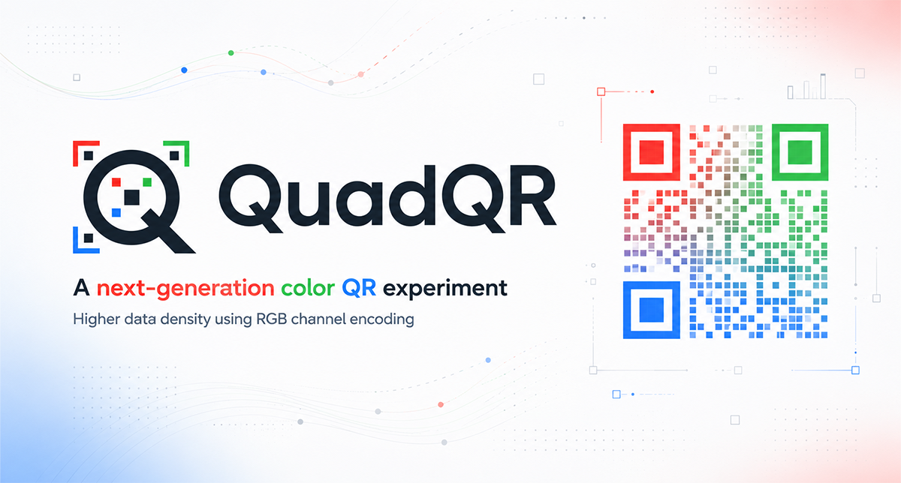

# QuadQR SDK

QuadQR is a color matrix code with RGBW cells and an optional Triangle16 high density mode. This repository contains the Rust codec and scanner, a desktop demo, a Rust/WebAssembly JavaScript adapter, and Android/Flutter bindings. The [original JavaScript implementation](https://github.com/akanshSirohi/QuadQR) is the v6 format reference.

> QuadQR needs a QuadQR-aware scanner. Standard black and white QR readers do not decode its color format. Test printed codes with the intended camera, lighting, size, and medium.

## Contents

| Path | Purpose |
| --- | --- |
| `crates/quadqr` | Reusable Rust encoder, decoder, renderer, scanner, compression, security, and reliability tools |
| `demo` | Desktop generator, image/camera scanner, reliability lab, and benchmark |
| `crates/quadqr-wasm`, `packages/quadqr-js` | Experimental browser and Node.js JavaScript adapter backed by Rust/WASM |
| `crates/quadqr-native`, `android`, `packages/quadqr-android` | C ABI/JNI bridge and Java/Kotlin Android AAR |
| `packages/quadqr-flutter` | Android Flutter FFI package and example |
| `documentation` | [Documentation site](https://akanshsirohi.github.io/QuadQR-SDK/) for all four platforms (available after GitHub Pages is enabled) |

The core supports versions 1–40, RGBW and Triangle16, Reed–Solomon error correction, LZ/DEFLATE/Brotli compression, AES-256-GCM payload encryption, Ed25519 signing, SVG/PNG output, and perspective-aware scanning. The default Rust features enable image, compression, security, and parallel support.

To preview the documentation site locally, run `python -m http.server 8765` from the repository root and open `http://127.0.0.1:8765/documentation/`. The site contains the complete API guides as HTML. After creating the public repository, set **Settings → Pages → Build and deployment → Source** to **GitHub Actions**; `.github/workflows/docs.yml` deploys `documentation/` on pushes to `main` or `master`. The resulting URL will be `https://akanshsirohi.github.io/QuadQR-SDK/`.

When changing a source guide, regenerate its site page and check local links:

```sh
python -m pip install -r scripts/requirements-docs.txt
python scripts/build-doc-site.py
python scripts/check-doc-links.py
```

## Requirements

- **Rust and desktop:** Install a current stable Rust toolchain through [rustup](https://rustup.rs/). The desktop app needs a graphical session; camera capture needs a host webcam. On Linux, install any system development libraries required by `eframe`, `rfd`, and `nokhwa`.
- **JavaScript/WASM:** Node.js 20+, npm, and rustup. `npm run setup:wasm` installs the WASM target, pinned nightly with `rust-src`, and `wasm-pack` 0.15+ if needed. The full build fetches a pinned `wasm-bindgen-rayon` Git dependency.
- **Android:** Android SDK and NDK, JDK 17–23 (21 recommended for the pinned Gradle 8.11.1), and `cargo-ndk` (`cargo install cargo-ndk`). Set `ANDROID_HOME` or `ANDROID_SDK_ROOT`; set `ANDROID_NDK_HOME` if NDK discovery fails. The scripts install the three required Rust targets. Android modules use compile SDK 36; the Flutter plugin specifies NDK `30.0.16248370`.
- **Flutter:** Flutter 3.22+ with Dart 3.3+, plus the Android requirements. The current Flutter binding targets Android, minimum SDK 21.

Windows Android helpers select a compatible JDK, including Android Studio's bundled JBR when its version is supported. Set `QUADQR_JAVA_HOME` to a JDK 17–23 installation if needed. A newer Studio JBR such as Java 25 is skipped. Gradle is downloaded into `.tools` automatically.

## Build and run

Run commands from the repository root unless the command changes directory. Use release mode for scanner performance measurements.

### Rust library and desktop demo

```sh
cargo build --workspace --release
cargo test --workspace --all-features --release
cargo run --release -p quadqr-demo
```

For a smaller core build:

```sh
cargo build -p quadqr --no-default-features
cargo build -p quadqr --no-default-features --features image,compression
```

Core features are `image`, `image-codecs`, `compression`, `security`, and `parallel`; see [the manifest](crates/quadqr/Cargo.toml). `run-demo.bat` and `./run-demo.sh` are desktop shortcuts. Run the camera demo on the host OS because WSL may not expose the webcam.

### Browser and Node.js WASM

```sh
cd packages/quadqr-js
npm run setup:wasm
npm run check:source
npm run build:wasm
npm run verify:wasm
npm run check
npm run serve
```

Open `http://127.0.0.1:8080/demo/`. The server sends COOP/COEP headers for browser threads. From the root, `run-wasm-demo.bat` or `./run-wasm-demo.sh` runs the whole flow; `npm run verify` combines source check, build, artifact check, and API check.

Build outputs are `packages/quadqr-js/wasm/{single,threaded,node}`. Set `QUADQR_SKIP_THREADED=1` for a baseline browser and Node build. Browser initialization falls back to baseline when threads are unavailable. The JavaScript package is **private** and remains an experimental compatibility port; the original JavaScript package is the recommended web implementation. See the [WASM package guide](packages/quadqr-js/README.md). `npm run sync:demo` is optional and fetches pinned reference styling.

### Android libraries and AAR

| Goal | Windows | macOS/Linux | Output |
| --- | --- | --- | --- |
| Build native libraries | `build-android.bat` | `./build-android.sh` | `android-libs/<abi>/libquadqr.so` |
| Package existing libraries | `build-aar.bat` | `./build-aar.sh` | `dist/quadqr-android-release.aar` |
| Build both | `build-android-release.bat` | `./build-android-release.sh` | Both outputs |

Supported ABIs are `arm64-v8a`, `armeabi-v7a`, and `x86_64`. Add the AAR to an Android app and use `QuadQR.getInstance()` from Java or Kotlin. See the [Android overview](android/README.md), [Java guide](android/JAVA.md), [Kotlin guide](android/KOTLIN.md), and [C header](android/include/quadqr.h).

### Flutter Android package

| Goal | Windows | macOS/Linux | Output |
| --- | --- | --- | --- |
| Build/sync native libraries and analyze if Flutter is installed | `build-flutter.bat` | `./build-flutter.sh` | Plugin `jniLibs` |
| Validate and create package ZIP | `build-flutter-release.bat` | `./build-flutter-release.sh` | `dist/quadqr-flutter.zip` |

The preparation script can finish without Flutter after syncing native libraries; the ZIP requires Flutter. Run the example after preparation:

```sh
cd packages/quadqr-flutter/example
flutter pub get
flutter run
```

See the [Flutter guide](packages/quadqr-flutter/README.md) for dependency setup, Dart examples, and the YUV camera path.

## Rust quick start

Use a path dependency while developing locally:

```toml
[dependencies]
quadqr = { path = "../QuadQR-SDK/crates/quadqr" }
```

```rust
use quadqr::{decode_matrix, encode_text, EccLevel, EncodeOptions};

fn main() -> quadqr::Result<()> {
    let options = EncodeOptions { ecc: EccLevel::M, ..Default::default() };
    let code = encode_text("Hello QuadQR", options)?;
    let decoded = decode_matrix(&code.matrix)?;
    assert_eq!(decoded.payload, b"Hello QuadQR");
    Ok(())
}
```

Use `encode_application_text` / `encode_application_bytes` with `ApplicationEncodeOptions` for compression, encryption, or signing envelopes. Scan image bytes with `scan_buffer`; render with `render_svg` / `to_png`. The public exports are listed in [the core library](crates/quadqr/src/lib.rs).

## Format and compatibility

The Rust codec follows v6: versions 1–40 use `21 + 4 × (version − 1)` cells per side; RGBW maps red/green/blue/white to 0/1/2/3; Triangle16 splits cells diagonally. The protected header, masking, CRC-32, Reed–Solomon parity, compression envelope, and security envelope match the JavaScript reference. The decoder also accepts legacy v5 where the reference does. Browser camera lifecycle and worker scheduling belong to the JavaScript adapter.

Cross-language conformance matters when changing the format. See the original [format documentation](https://github.com/akanshSirohi/QuadQR/blob/master/FORMAT.md) and [specification](https://github.com/akanshSirohi/QuadQR/blob/master/SPECIFICATION.md).

## Contributing and license

See [CONTRIBUTING.md](CONTRIBUTING.md) for development checks and platform testing. QuadQR SDK is licensed under [AGPL-3.0-only](LICENSE), matching the original implementation. Contributions are submitted under that license.
